# คู่มือเริ่มใช้งาน PrakaiPOS

ตั้งแต่สมัครร้าน เปิดร้าน สร้างเมนู จนขายบิลแรก — ทำตามลำดับได้เลย ใช้เวลาราว 15–20 นาที
ภาพประกอบทุกภาพมาจากการลองใช้งานจริงตามขั้นตอนในคู่มือนี้ (ร้านตัวอย่างชื่อ "ครัวป้าหน่อย")

## ก่อนเริ่ม เตรียมอะไรบ้าง

- แท็บเล็ตหรือคอมที่เปิดเว็บเบราว์เซอร์ได้ (แนะนำ Chrome)
- อินเทอร์เน็ต — **จำเป็นเฉพาะตอนสมัคร ตั้งค่าเครื่อง เข้าระบบครั้งแรก และแก้ไขเมนู/ตั้งค่าร้าน**
  หลังจากนั้นขายต่อได้แม้เน็ตหลุด แล้วบิลจะซิงก์ขึ้นระบบเองเมื่อเน็ตกลับมา
- รายการเมนูกับราคา และรูปอาหาร (ไม่มีรูปก็ได้)
- เลขพร้อมเพย์ของร้าน (ถ้าจะรับเงินโอน)

---

## ขั้นที่ 1 — สมัครร้าน

1. เปิดหน้าเว็บ PrakaiPOS จะเจอหน้า **"ตั้งค่าเครื่องครั้งแรก"**
2. กดลิงก์ **"ยังไม่มีร้าน? สมัครร้านใหม่"**

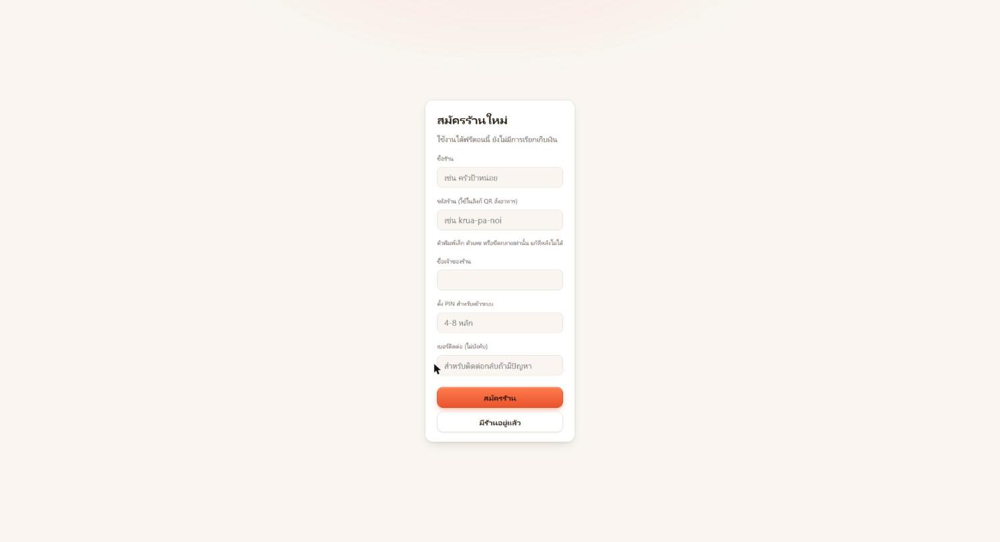

3. กรอกข้อมูล

   | ช่อง | ใส่อะไร |
   | --- | --- |
   | ชื่อร้าน | เช่น ครัวป้าหน่อย |
   | รหัสร้าน | ตัวพิมพ์เล็ก ตัวเลข หรือขีดกลาง เช่น `krua-pa-noi` — **ใช้ในลิงก์ QR สั่งอาหาร และแก้ทีหลังไม่ได้** |
   | ชื่อเจ้าของร้าน | ชื่อที่จะแสดงในระบบ |
   | PIN | ตัวเลข 4–8 หลัก ใช้เข้าระบบทุกครั้ง จำให้ได้และอย่าบอกคนอื่น |
   | เบอร์ติดต่อ | ไม่บังคับ ไว้ให้ทีมงานติดต่อกลับ |

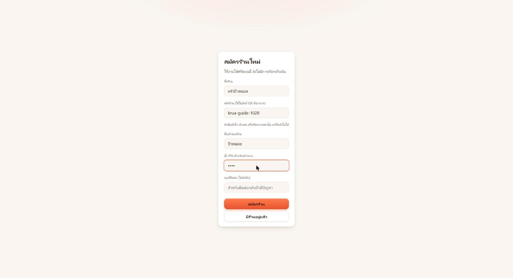

4. กด **"สมัครร้าน"**

> ร้านที่สมัครใหม่อยู่ในแผน **ทดลอง** ใช้ฟรี ยังไม่เรียกเก็บเงิน ดู[ข้อจำกัดของแผนทดลอง](#ข้อจำกัดของแผนทดลอง)ท้ายคู่มือ

## ขั้นที่ 2 — ตั้งค่าเครื่อง (ทำครั้งเดียวต่อเครื่อง)

สมัครสำเร็จแล้วระบบพากลับมาหน้า "ตั้งค่าเครื่องครั้งแรก" พร้อม **เติมรหัสร้านและ PIN ให้เอง**

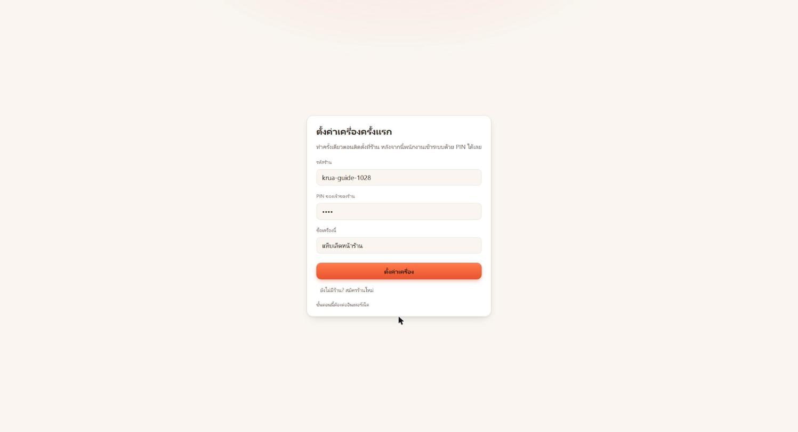

1. ตรวจว่า **รหัสร้าน** ถูกต้อง
2. ตั้ง **ชื่อเครื่องนี้** เช่น "แท็บเล็ตหน้าร้าน" (ไว้แยกว่าเป็นเครื่องไหน)
3. กด **"ตั้งค่าเครื่อง"**

ถ้าขึ้น "ไม่พบรหัสร้านนี้" ให้ตรวจตัวสะกดรหัสร้าน ถ้าขึ้น "มีเครื่องอื่นกำลังตั้งค่าพร้อมกัน" ให้กดยืนยันซ้ำ

**เครื่องที่สอง (เช่น แท็บเล็ตของครัว):** เปิดเว็บ → กรอกรหัสร้าน + PIN เจ้าของร้าน → ตั้งชื่อเครื่อง → ตั้งค่าเครื่อง ทำตามหน้าเดียวกันนี้ ไม่ต้องสมัครใหม่

## ขั้นที่ 3 — เข้าระบบ

หลังตั้งค่าเครื่อง จะเจอหน้า **"ใครกำลังใช้งาน"** ชื่อเจ้าของร้านขึ้นให้เลือกแล้ว

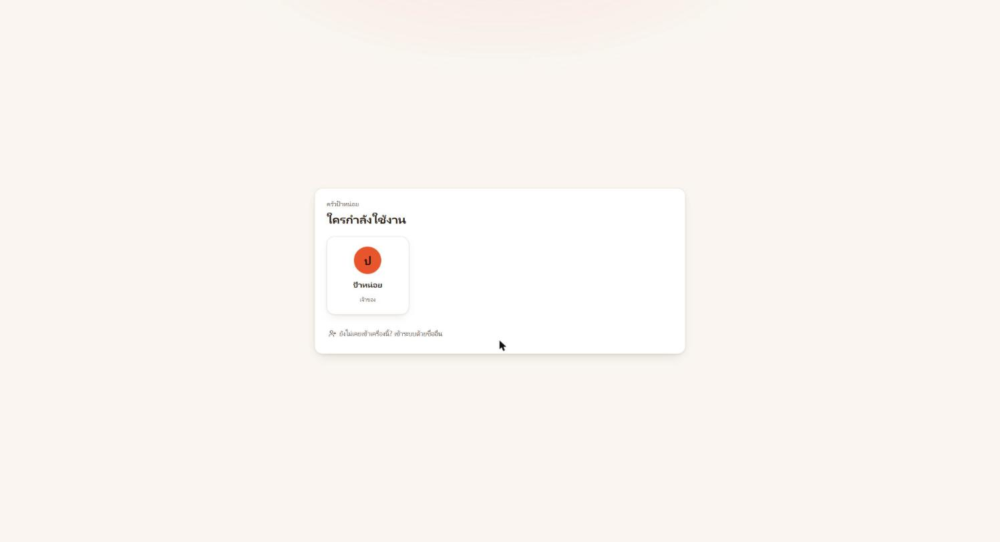

แตะชื่อ แล้วกด PIN บนแป้นตัวเลข

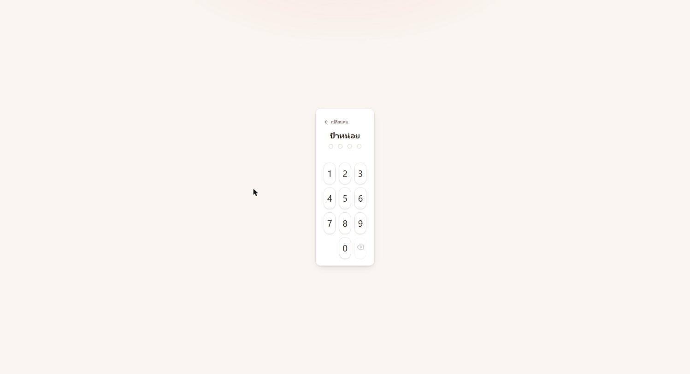

- กรอก PIN ผิดหลายครั้งจะถูกล็อกชั่วคราว ต้องรอตามเวลาที่ระบบบอก
- เครื่องล็อกตัวเองเมื่อไม่ได้ใช้งานสักพัก หรือกดชื่อมุมขวาบน ("ชื่อ · ล็อก") เพื่อล็อกเอง
- พนักงานที่ไม่เคยเข้าเครื่องนี้ กด **"ยังไม่เคยเข้าเครื่องนี้? เข้าระบบด้วยชื่ออื่น"** แล้วกรอกชื่อผู้ใช้ (เช่น `รหัสร้าน-nong`) กับ PIN
  ต้องมีอินเทอร์เน็ตครั้งแรกเท่านั้น หลังจากนั้นชื่อจะขึ้นให้เลือกเอง

เข้าแล้วจะเจอ **หน้าแรก** ที่มีการ์ดไปหน้าต่าง ๆ

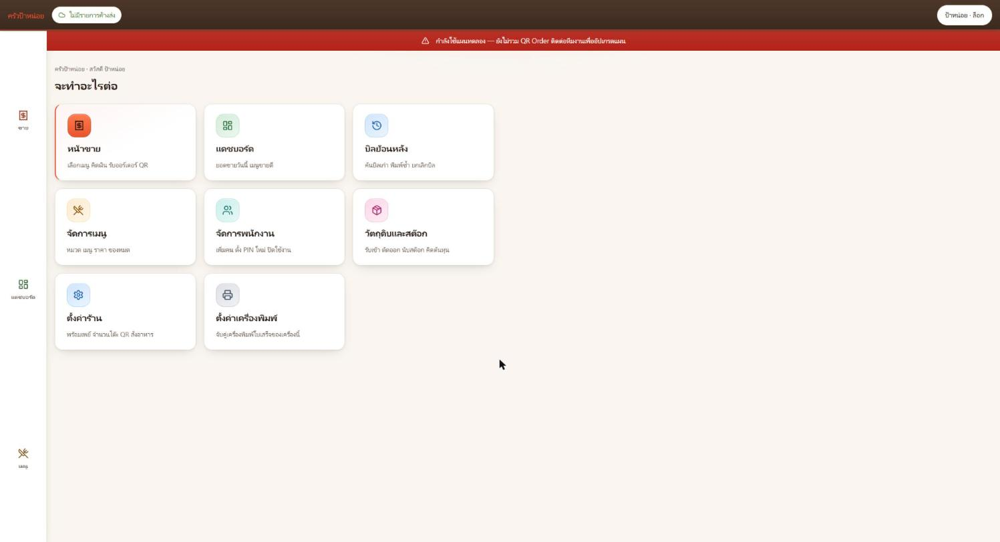

- จอกว้าง (คอม): แถบนำทางอยู่ด้านซ้าย / จอแท็บเล็ต: อยู่ด้านล่าง มี **ขาย / โต๊ะ / แดชบอร์ด / เมนู**
  (เมนู "โต๊ะ" จะโผล่หลังเปิดผังโต๊ะในขั้นที่ 5)
- แถบสีแดงด้านบน "กำลังใช้แผนทดลอง" คือแผนของร้านตอนนี้ ไม่ใช่ข้อผิดพลาด

## ขั้นที่ 4 — เพิ่มพนักงาน (ถ้ามี)

หน้าแรก → **จัดการพนักงาน** → **เพิ่มพนักงาน**

- ใส่ชื่อที่แสดง, username (ใช้ล็อกอิน), บทบาท (พนักงาน / เจ้าของร้าน) และ PIN เริ่มต้น 4–8 หลัก
- บอก PIN ให้พนักงานเอง แล้วให้เขาเข้าระบบครั้งแรกบนเครื่องร้านตอนมีเน็ต
- ลืม PIN: กด **ตั้ง PIN ใหม่** (PIN เดิมใช้ไม่ได้ทันที)
- คนที่ออกแล้ว: กด **ปิดใช้งาน** เขาจะล็อกอินไม่ได้อีก (เปิดกลับได้ภายหลัง)

> พนักงานทั่วไปกด "ของหมด" ได้ แต่เพิ่ม/แก้/ลบเมนู และตั้งค่าร้านได้เฉพาะบัญชี **เจ้าของร้าน**

## ขั้นที่ 5 — ตั้งค่าร้าน (เจ้าของร้าน)

หน้าแรก → **ตั้งค่าร้าน** (ต้องต่อเน็ต)

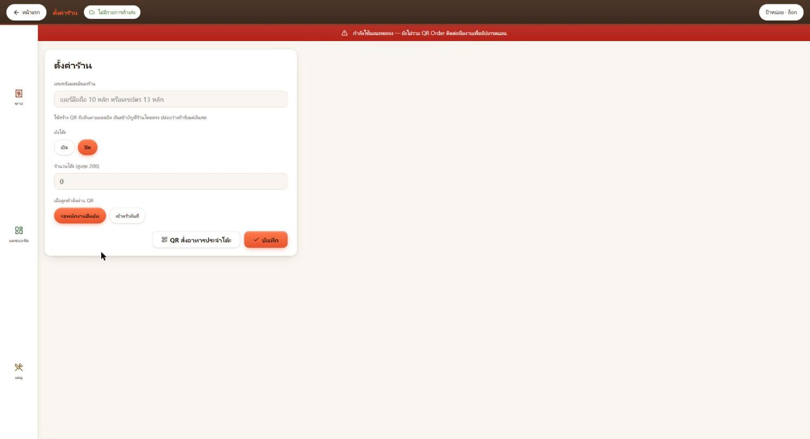

| ช่อง | ใส่อะไร |
| --- | --- |
| เลขพร้อมเพย์ของร้าน | เบอร์มือถือ 10 หลัก หรือเลขบัตรประชาชน/ผู้เสียภาษี 13 หลัก ปล่อยว่างได้ถ้ารับแต่เงินสด |
| ผังโต๊ะ | เปิด/ปิด — เปิดเมื่อร้านมีโต๊ะนั่งและอยากดูว่าโต๊ะไหนว่าง |
| จำนวนโต๊ะ | 1–200 (ต้องใส่ถ้าเปิดผังโต๊ะ) |
| เมื่อลูกค้าสั่งผ่าน QR | **รอพนักงานยืนยัน** (แนะนำ กันสั่งแกล้ง) หรือ **เข้าครัวทันที** |

ระบบตรวจรูปแบบเลขพร้อมเพย์ให้ ถ้าผิดจะไม่ให้บันทึกและบอกว่าต้องเป็นเลขกี่หลัก

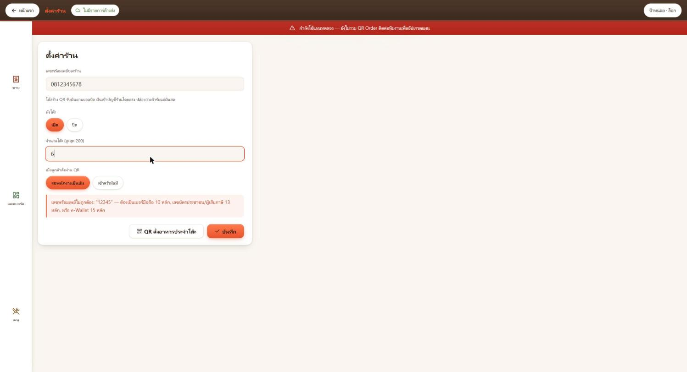

กด **บันทึก** แล้วค่ามีผลทันที เมนู **โต๊ะ** โผล่ในแถบนำทาง และตอนรับเงินจะมี QR พร้อมเพย์ตามยอดบิล
เลขพร้อมเพย์ถูกเก็บในเครื่อง จึงสร้าง QR รับเงินได้แม้เน็ตหลุด

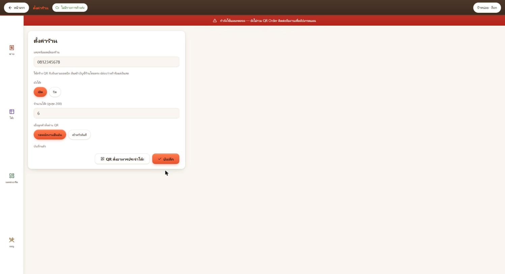

## ขั้นที่ 6 — สร้างเมนู

ไปที่ **เมนู** (แถบนำทาง หรือหน้าแรก → จัดการเมนู) ต้องใช้บัญชีเจ้าของร้านและต่อเน็ต

### 6.1 สร้างหมวดก่อน

1. กด **"เพิ่มหมวด"**
2. ใส่ **ชื่อหมวด** เช่น ข้าว, เส้น, เครื่องดื่ม
3. เลือก **ประเภท: อาหาร หรือ เครื่องดื่ม** — หน้าขายและหน้าลูกค้าจะจัดอาหารขึ้นก่อน และใส่ไอคอน/สีแยกให้
4. กด **บันทึก**

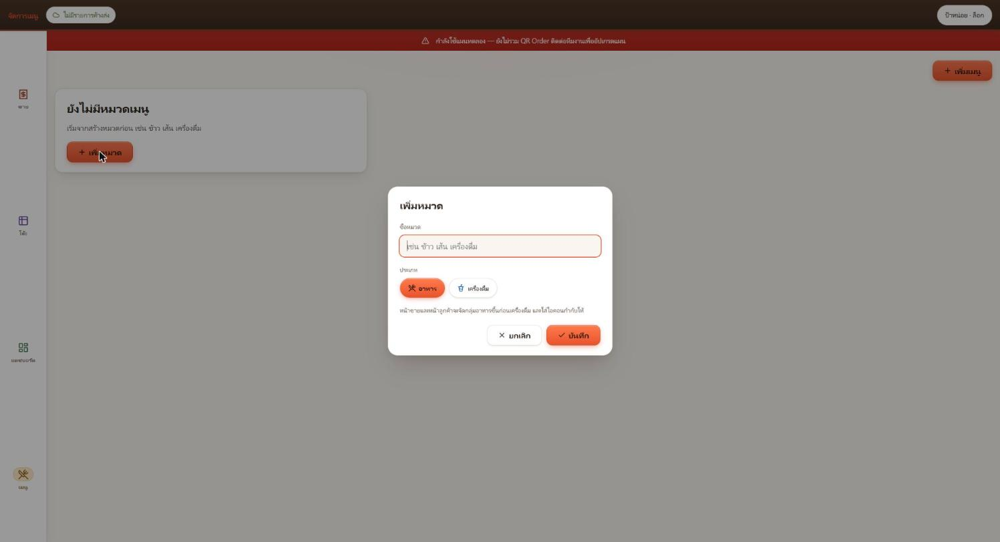

แก้ชื่อหรือลบหมวดได้จากปุ่ม **แก้หมวด / ลบหมวด** (ปุ่มลบจะโผล่เมื่อหมวดว่าง)

### 6.2 เพิ่มเมนู

1. กด **"เพิ่มเมนู"** มุมขวาบน
2. กรอก **ชื่อเมนู**, **ราคา (บาท)** เช่น `60` หรือ `60.50`, เลือก **หมวด**, และ **รูป** (ไม่บังคับ ระบบย่อรูปให้อัตโนมัติ)
3. กด **บันทึก**

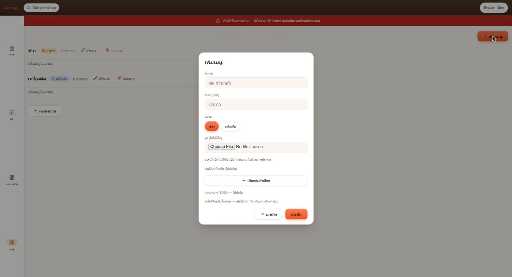

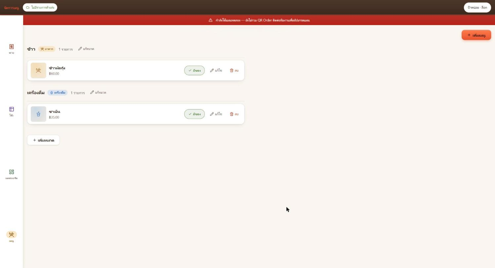

### 6.3 ตัวเลือก/ท็อปปิ้ง (ไม่บังคับ)

ในหน้าเพิ่ม/แก้เมนู กด **เพิ่มกลุ่มตัวเลือก**

- ตั้งชื่อกลุ่ม เช่น "ระดับความเผ็ด" หรือ "ตัวเลือกเพิ่ม"
- กด **เพิ่มตัวเลือก** ใส่ชื่อ (เช่น เผ็ดน้อย, ไข่ดาว) และราคาที่บวกเพิ่ม (ถ้ามี)
- ติ๊ก **"เลือกได้หลายอย่าง"** ถ้าให้เลือกมากกว่าหนึ่ง (เช่น ท็อปปิ้ง)
- ติ๊ก **"ต้องเลือกก่อนสั่ง"** ถ้าต้องเลือกเสมอ
- แถวที่ไม่ได้ตั้งชื่อจะถูกตัดทิ้งตอนบันทึก กดเพิ่มทิ้งไว้ได้

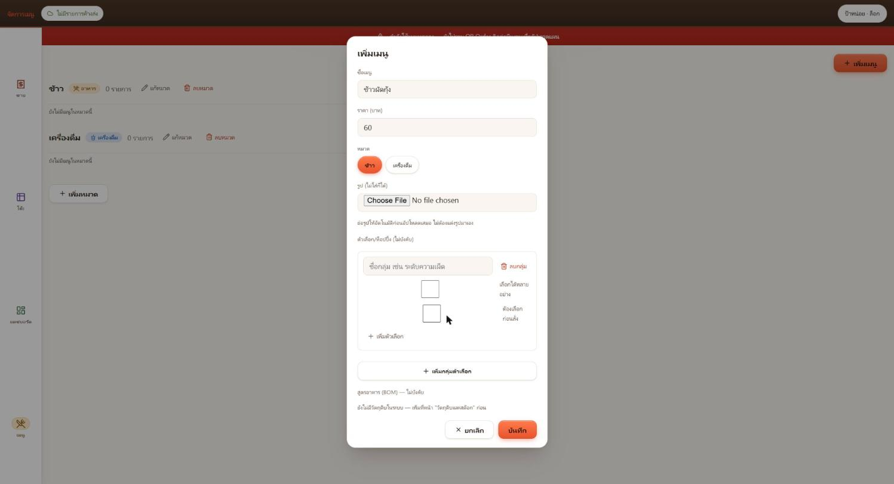

### 6.4 สูตรอาหาร คิดต้นทุน (ไม่บังคับ แต่แนะนำ)

1. หน้าแรก → **วัตถุดิบและสต๊อก** → เพิ่มวัตถุดิบ (เช่น กุ้ง, ไข่) พร้อมหน่วยและจำนวนที่มี
2. กลับมาแก้เมนู → ช่อง "สูตรอาหาร (BOM)" → **เพิ่มวัตถุดิบในสูตร** ใส่จำนวนที่ใช้ต่อ 1 จาน

ผลที่ได้: รายการเมนูแสดง **ต้นทุนและ % กำไร** และ **ตัดสต๊อกอัตโนมัติ** ทุกครั้งที่ขาย
(เมนูที่ยังไม่ตั้งสูตรจะนับต้นทุนเป็น 0 กำไรในแดชบอร์ดจึงเท่ากับยอดขาย)

### 6.5 "ของหมด"

ในรายการเมนูมีปุ่ม **มีของ / ของหมด** กดสลับได้ทุกคน และ **ใช้ได้แม้ไม่มีเน็ต**
เมนูที่ของหมดจะขึ้นป้าย "ของหมด" ทั้งหน้าขายและหน้าลูกค้า

## ขั้นที่ 7 — ขายบิลแรก

ไปที่ **ขาย**

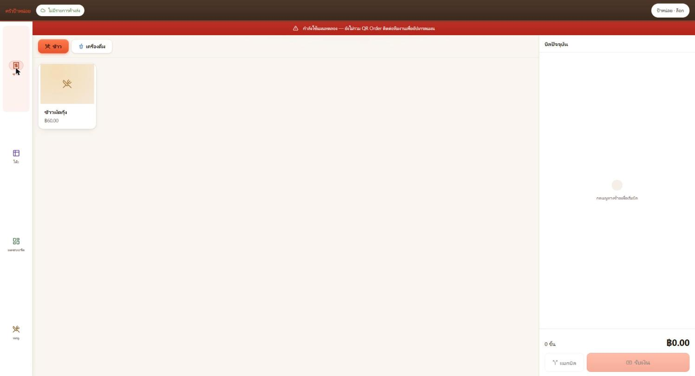

1. แตะหมวดแล้วแตะเมนูทางซ้ายเพื่อใส่ตะกร้า (แตะซ้ำเพิ่มจำนวน) เมนูที่มีตัวเลือกจะมีหน้าต่างให้เลือกก่อน
2. ตะกร้าทางขวา
   - **+ / −** ปรับจำนวน, **ลบ** เอาออก, **+ หมายเหตุ** เช่น "ไม่ใส่ผักชี", **ล้างบิล** เริ่มใหม่

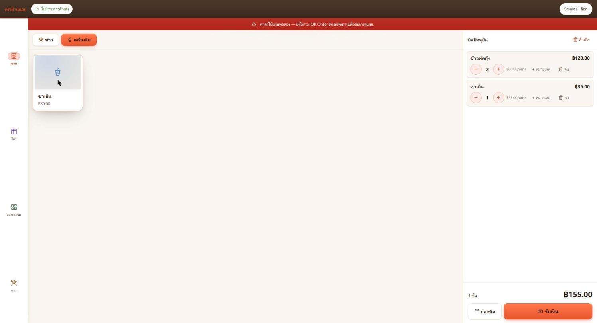

3. กด **"รับเงิน"** แล้วเลือกวิธีจ่าย
   - **เงินสด** — กรอกยอดที่รับมา ระบบคำนวณเงินทอน หรือกด "พอดี" ช่อง **ส่วนลด (บาท)** ใส่ได้ถ้ามี

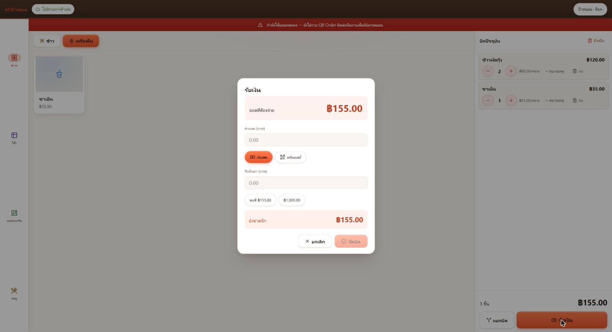

   - **พร้อมเพย์** — แสดง QR ตามยอดบิลให้ลูกค้าสแกน (ต้องตั้งเลขพร้อมเพย์ที่[ขั้นที่ 5](#ขั้นที่-5--ตั้งค่าร้าน-เจ้าของร้าน)ก่อน)

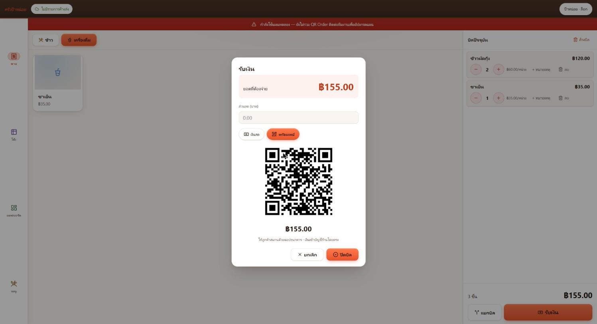

4. กด **"ปิดบิล"** จะขึ้น "ปิดบิลเลขที่ 1001 แล้ว" (เลขบิลเริ่มที่ 1001) และกด **พิมพ์ใบเสร็จ** ได้ถ้าจับคู่เครื่องพิมพ์ไว้

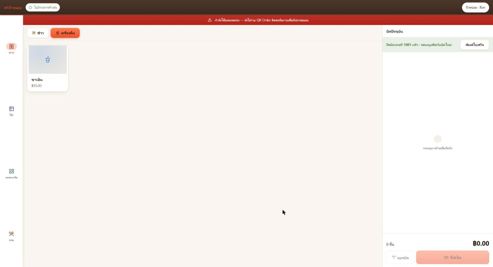

**แยกบิล:** ลูกค้าหลายคนหารกัน กด **"แยกบิล"** ในตะกร้าก่อนรับเงิน

### ดูผลย้อนหลัง

- **แดชบอร์ด**: ยอดขายวันนี้ จำนวนบิล เฉลี่ยต่อบิล กำไรโดยประมาณ และเมนูขายดี

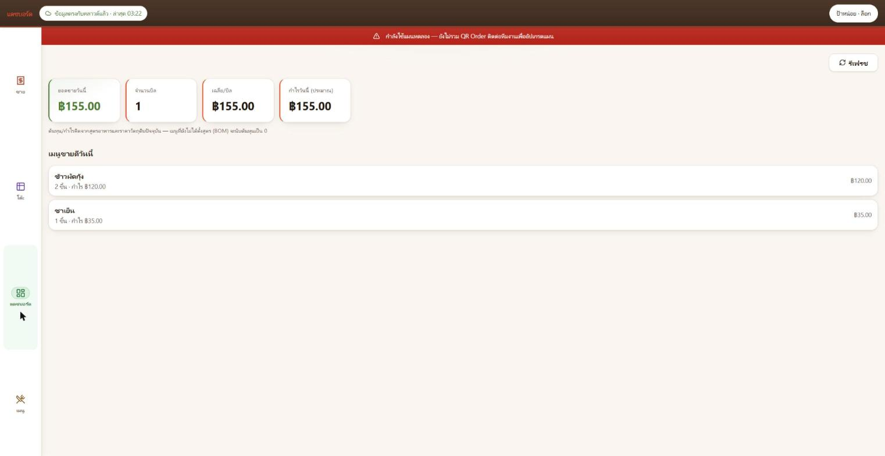

- **บิลย้อนหลัง** (หน้าแรก): ค้นบิล พิมพ์ซ้ำ แก้ไข ยกเลิก — การแก้ไขจะออกบิลใหม่แทน และบิลเดิมถูกยกเลิกเมื่อบิลใหม่ปิดสำเร็จ

## ตั้งค่าเสริมตามร้าน

### เครื่องพิมพ์ใบเสร็จ

หน้าแรก → **ตั้งค่าเครื่องพิมพ์** → เปิดเครื่องพิมพ์ Bluetooth → **จับคู่เครื่องพิมพ์** → เลือกอุปกรณ์จากรายการ
ใช้ได้เฉพาะ **Chrome บน Android และคอม** — iPad/Safari ไม่รองรับ (ใช้แสดงใบเสร็จบนหน้าจอแทน)

### ผังโต๊ะ

เปิดที่ **ตั้งค่าร้าน** (ขั้นที่ 5) แล้วเมนู **โต๊ะ** จะแสดงโต๊ะทั้งหมด โต๊ะว่างเป็นสีเขียว แตะโต๊ะเพื่อเปิดบิลหรือดูบิลของโต๊ะนั้น

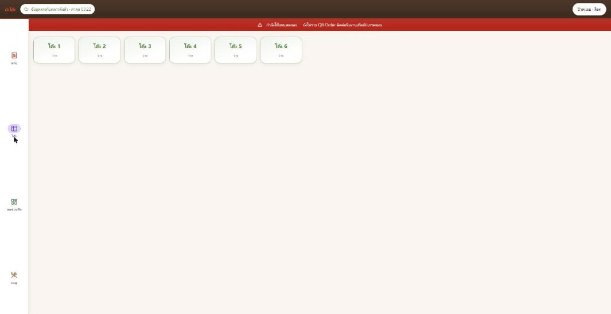

### QR สั่งอาหาร (ลูกค้าสั่งเอง)

> ต้องใช้แผนที่จ่ายเงิน — แผนทดลองสแกนและดูเมนูได้ แต่กดสั่งไม่ได้ (ดูข้อจำกัดท้ายคู่มือ)

**1) เตรียมป้าย QR ประจำโต๊ะ (เจ้าของร้าน)**

1. หน้าแรก → **ตั้งค่าร้าน** → **QR สั่งอาหารประจำโต๊ะ** (ต้องตั้งจำนวนโต๊ะก่อน และต้องต่อเน็ต)
2. ตรวจช่อง **ที่อยู่หน้าสั่งอาหารของลูกค้า** ให้เป็นเว็บหน้าลูกค้าจริงของร้าน (ระบบจำค่าไว้ในเครื่อง)
3. กด **พิมพ์ QR ทุกโต๊ะ** ได้ป้ายโต๊ะละใบ (ชื่อร้าน + QR + เลขโต๊ะ) ตัดแปะหรือเคลือบวางโต๊ะ

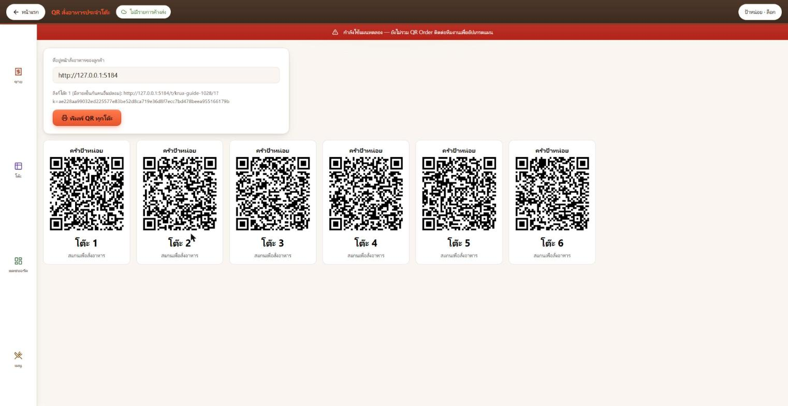

QR แต่ละใบมี **ลายเซ็นประจำโต๊ะ** ฝังในลิงก์ (`/t/<รหัสร้าน>/<เลขโต๊ะ>?k=...`) เพื่อกันคนนอกร้านเดาลิงก์มาสั่งแกล้ง
จึง **ต้องพิมพ์จากหน้านี้เท่านั้น** ลิงก์ที่พิมพ์มือโดยไม่มี `?k=` จะใช้ไม่ได้ และถ้าเปลี่ยนที่อยู่หน้าลูกค้า ให้พิมพ์ป้ายใหม่

**2) ฝั่งลูกค้า:** สแกน → ยืนยันว่านั่งโต๊ะนี้ถูกต้อง → เลือกเมนู → กด **สั่งอาหาร** สั่งเพิ่มได้ทุกรอบ

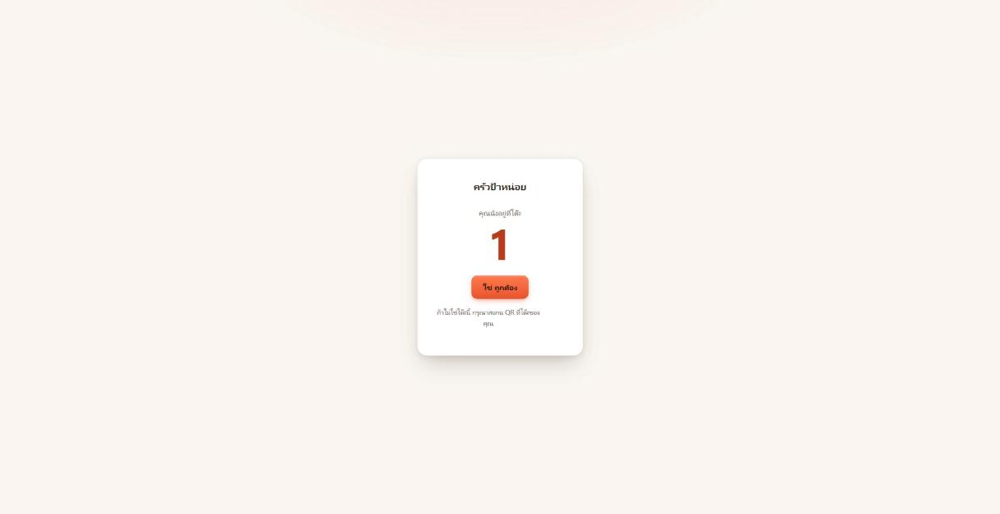

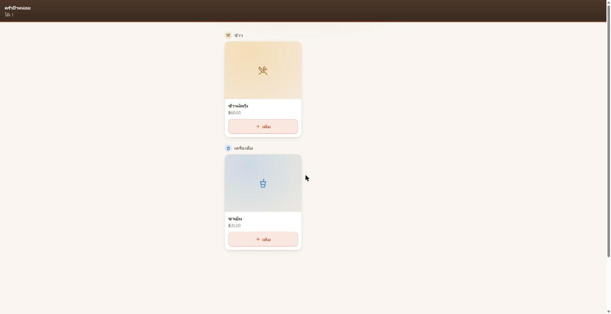

**3) ฝั่งร้าน:** ปุ่ม **ออร์เดอร์ QR** มุมขวาบนจะมีเสียงเตือนและตัวเลขรอยืนยัน กด **ยืนยัน** เพื่อส่งเข้าครัว หรือ **ปฏิเสธ**
(ถ้าตั้งเป็น "เข้าครัวทันที" ไม่ต้องกดยืนยัน) เมื่อลูกค้าจะจ่าย กด **รับเงิน** ที่โต๊ะนั้น ทุกรอบรวมเป็นบิลเดียว

> ต้องยืนยันออร์เดอร์ที่ค้างของโต๊ะให้ครบก่อนถึงจะรับเงินโต๊ะนั้นได้

## ข้อจำกัดของแผนทดลอง

| ฟีเจอร์ | แผนทดลอง | แผนที่จ่ายเงิน |
| --- | --- | --- |
| จำนวนเมนู | สูงสุด 40 รายการ | เพิ่มได้ตามแผน |
| QR สั่งอาหาร | ลูกค้าสแกนและดูเมนูได้ แต่ **กดสั่งไม่ได้** | รวม |
| ขายหน้าร้าน พร้อมเพย์ ผังโต๊ะ สต๊อก รายงาน | ใช้ได้ | ใช้ได้ |

ลูกค้าที่กดสั่งในแผนทดลองจะเห็นข้อความตามภาพ

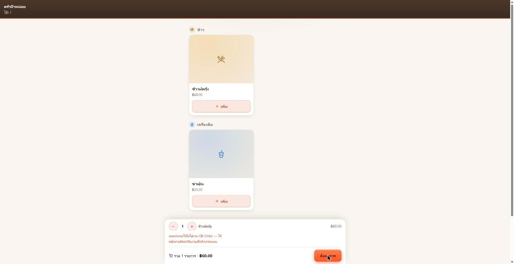

แผน Core 1,900 ฿/ปี และ Plus 3,500 ฿/ปี — ติดต่อทีมงานเพื่ออัปเกรดและต่ออายุ
เมื่อใกล้หมดอายุจะมีแถบแจ้งเตือนด้านบนของแอป

## ปัญหาที่พบบ่อย

| อาการ | วิธีแก้ |
| --- | --- |
| "การสมัครร้านต้องต่ออินเทอร์เน็ต" | ต่อเน็ตแล้วลองใหม่ ขั้นสมัคร/ตั้งค่าเครื่อง/เข้าครั้งแรกต้องออนไลน์ |
| "PIN ไม่ถูกต้อง เหลืออีก N ครั้ง" | กรอกใหม่ ถ้าผิดครบจะถูกล็อกชั่วคราว เจ้าของร้านตั้ง PIN ใหม่ให้ได้ที่ จัดการพนักงาน |
| พนักงานไม่เห็นชื่อในเครื่อง | ต้องเข้าระบบครั้งแรกบนเครื่องนี้ตอนมีเน็ตก่อน |
| ตั้งค่าร้านไม่ได้ | ต้องเป็นบัญชีเจ้าของร้านและต่อเน็ต |
| "เลขพร้อมเพย์ไม่ถูกต้อง" | ใส่เบอร์มือถือ 10 หลัก หรือเลข 13 หลัก (ใส่ขีดคั่นได้) |
| ไม่เห็นเมนู "โต๊ะ" | ยังไม่ได้เปิดผังโต๊ะหรือยังไม่ใส่จำนวนโต๊ะ ที่ ตั้งค่าร้าน |
| พร้อมเพย์ไม่ขึ้น QR | ยังไม่ได้ตั้งเลขพร้อมเพย์ — หน้าแรก → ตั้งค่าร้าน |
| เพิ่มเมนูไม่ได้ | ต้องใช้บัญชีเจ้าของร้านและต่อเน็ต / ถ้าครบ 40 รายการต้องอัปเกรดแผน |
| ลูกค้าสแกน QR แล้วขึ้น "ลิงก์นี้ไม่สมบูรณ์" หรือ "ไม่ถูกต้อง" | ลิงก์ไม่มีลายเซ็น `?k=` — ให้พิมพ์ป้ายใหม่จากหน้า QR สั่งอาหารประจำโต๊ะ |
| ลูกค้ากดสั่งแล้วขึ้น "แผนทดลองไม่รวม QR Order" | ต้องอัปเกรดแผนกับทีมงาน |
| เน็ตหลุดระหว่างขาย | ขายต่อได้ตามปกติ บิลจะส่งขึ้นระบบอัตโนมัติเมื่อเน็ตกลับมา (ดูไอคอนสถานะซิงก์ด้านบน) |
